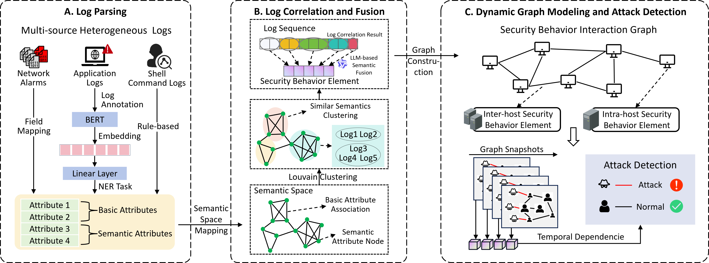

# SERDGRAD: Semantic Event Reconstruction for Dynamic Graph-based Attack Detection

This repository provides the **public resources** associated with the research paper:  **"SERDGRAD: Semantic Event Reconstruction for Dynamic Graph-based Attack Detection"**.

We propose a **dynamic graph-based attack detection method** for **multi-source heterogeneous security logs**.

In this repository, we provide:

- The **Loghub dataset** and a description of attack scenarios in our **laboratory-collected dataset**.
- The **shell command parsing method** used in our approach.
- The **event-tag fusion prompt template** for multi-source security behavior summarization.
- A **network alarm normalization example** for heterogeneous alert schemas.
- A **port-to-service mapping table** for reference.

## Datasets

Our evaluation utilizes two distinct datasets:

1. **Loghub Dataset** – A publicly available **large-scale system log collection** for AI-driven log analytics research.
2. **Laboratory-Collected Dataset** – A dataset collected in a controlled testbed, containing **crafted attack scenarios** for security analysis.

### Loghub  dataset:

The **Loghub dataset** provides **real-world system logs** from **distributed systems, supercomputers, operating systems, mobile systems, and server applications**. It is widely used for **log analysis, anomaly detection, and security research**.

- The dataset can be accessed from: 🔗 [logpai/loghub: A Large Collection of System Log Datasets for AI-Driven Log Analytics](https://github.com/logpai/loghub)

### Laboratory-Collected Dataset:

- **Download** and unzip the dataset from [Google Drive](https://bit.ly/40WNDcn).
  - The `savestore.csv` file contains **application logs** exported from **Elasticsearch**, including `.bash_history` and `auth.log`.
  
  - **Raw network traffic** from involved hosts is stored in separate folders.
  
  - Our dataset includes **two attack scenarios**, each consisting of **ten attack steps**.
  
- For details on scenario design, attack step descriptions, and corresponding time windows, refer to:
   [📄 Attack Steps Documentation (attack_step.md)](attack_step.md)

## Shell Command Parsing Rules

We developed a [📌**rule-based shell command parser** (cmd_parse.py)](cmd_parse.py) to analyze command-line inputs, extract key entities, and classify commands based on their function and potential security risks.

The **`Parse_cmd` class** is designed to:

- **Extract command type and arguments** from shell command execution.
- **Identify sensitive operations**, such as privilege escalation (`sudo`) and remote execution (`ssh`).
- **Classify commands** into categories like **file operations, networking, system management, and security-related activities**.

## Security Behavior Fusion Prompt

We provide an [📌**ICIO prompt template** (`fusion_prompt.py`)](fusion_prompt.py) for fusing heterogeneous evidence into a concise, event-oriented security tag.

The template emphasizes:

- **Source confidence weighting** (network signatures > host templates > command traces).
- **Cross-source correlation** to keep tags consistent and meaningful across similar events.
- **Actionable event naming** focused on attack behavior (e.g., reconnaissance, exploitation, lateral movement).

## Network Alarm Normalization

The [📌**network normalization module** (`network_normalization.py`)](network_normalization.py) provides a compact rule-based example to normalize heterogeneous alarm fields into a shared schema.

It includes:

- A **shared alarm schema** definition.
- A **field mapping dictionary** for common source variations.
- **Protocol/port type normalization** and optional service enrichment using `port_service.csv`.

## Port-to-Service Mapping Table

The [**Port-to-Service Mapping Table**](port_service.csv) provides a reference for commonly assigned ports and their associated protocols and services. Each row represents a **specific port number**, detailing its assignment across different transport protocols (**TCP, UDP, SCTP, DCCP**) and a brief **description** of its function.

The table structure is as follows:

| Column Name     | Description                                                  |
| --------------- | ------------------------------------------------------------ |
| **Port**        | The assigned port number.                                    |
| **TCP**         | Indicates if the port is assigned for **TCP** communication (`Yes`, `Assigned`, or blank if unassigned). |
| **UDP**         | Indicates if the port is assigned for **UDP** communication. |
| **SCTP**        | Indicates if the port is assigned for **SCTP** communication. |
| **DCCP**        | Indicates if the port is assigned for **DCCP** communication. |
| **Description** | A brief explanation of the port’s function and usage.        |
